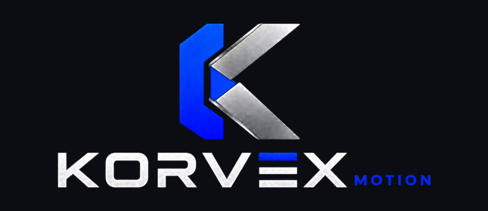

<p align="center"></p>

# Korvex Motion

Estudio de motion graphics **hecho en código** para reels de Instagram (9:16), ads, launches y explainers. Lo usa Korvex Dev para sus productos y clientes. Es un plugin de Claude Code con un flujo por roles:

```
/korvex-motion <idea>
 intake con preguntas → Investigador → Productor (PUERTA 1) → Guionista (PUERTA 2)
 → Editor + QA + Juez (PUERTA 3, automática) → tú apruebas (PUERTA 4) → entrega
```

- **Cada video es una página HTML** con un timeline de GSAP en pausa. Todo sale de `window.seek(t)`, así que el mismo cuadro da siempre los mismos píxeles.
- **El render es determinista:** Playwright captura cada cuadro con motion blur de 4 sub-cuadros y ffmpeg arma el MP4.
- **La música y los SFX se componen en Python** (`_studio/audio/synth.py`) y salen masterizados a -14 LUFS.
- **QA automático** (`qa.py`): zona segura de IG, tiempos de lectura, cortes, loudness y peso.
- **Costuras medidas** (`seams.py`) y **cuadros dorados** entre revisiones (`golden.py`).
- **Un método por rol** (`_studio/metodo/`) con puertas de aprobación. El hook `gate_check.py` no deja escribir el guion, el video ni la entrega sin tu OK.
- **Radar de tendencias** (`_studio/refs/tendencias.md`): un catálogo de técnicas con estado nueva / probada / gastada. El Investigador lo actualiza solo, y cada cliente lleva un registro de su look para que sus videos no salgan siempre con la misma secuencia de edición.

> El método está escrito en español y pensado para negocios de República Dominicana. Donde dice "Yeyow", pon tu nombre: es quien aprueba las puertas.

## Requisitos
- Python 3.11+, ffmpeg, Node (para Claude Code).
- Paquetes: `pip install playwright numpy opencv-python scipy` y después `python -m playwright install chromium`.
- **GSAP no viene en el repo** (ver Licencias). Bájalo con:
  ```
  python _studio/setup/get_gsap.py
  ```
- En Windows, `_studio/setup/instalar-windows.ps1` instala todo y prueba un render.

## Instalar el plugin
En Claude Code:
```
/plugin marketplace add yedinrumba-eng/korvex-motion
/plugin install korvex-motion@korvex
```
Abre la sesión **en la carpeta del repo**: el flujo usa rutas relativas a ella.

## Empezar
```
/korvex-motion:nuevo-cliente MI-CLIENTE https://su-web.com
/korvex-motion un reel de 20 s que muestre cómo se pide por WhatsApp
```
El intake te hace preguntas con opciones. Después, cada rol escribe su documento en `MI-CLIENTE/videos/01-nombre/`, de `01-research.md` a `05-revision.md`, y se para en cada puerta.

Otros comandos: `/korvex-motion:aprobar`, `/korvex-motion:cambios`, `/korvex-motion:estado` y `/korvex-motion:radar`.

Sin el plugin también funciona a mano (desde `MI-CLIENTE/videos/01-nombre/`):
```
python ../../../_studio/preview.py index.html prev.png 1,5,10 6
python ../../../_studio/render.py --html index.html --out borrador.mp4 --workers 4 --draft --audio music.wav
python ../../../_studio/tools/qa.py --video borrador.mp4 --html index.html --out qa
```
El manual del motor está en `_studio/README.md`. Para probarlo sin cliente: `_studio/test/kit-motion.html` y `_studio/test/seams-demo.html`.

## Qué hay aquí
```
plugin/                    el plugin de Claude Code (skill, 5 agentes, comandos, hook)
.claude-plugin/            el marketplace (para /plugin marketplace add)
_studio/                   el motor
  render.py preview.py cues.py
  lib/kit.js kit.css       el kit de animación (K.*)
  audio/synth.py           instrumentos, SFX y master
  tools/                   qa, seams, golden, deliver, key, nuevo_video, nuevo_producto, gate_check
  metodo/                  el método de cada rol, recetas, categorías, intake
  plantillas/              plantillas 01–05 de los documentos de cada video
  refs/tendencias.md       el radar de tendencias
  sfx/                     SFX de Kenney (CC0)
  fonts/                   Inter, JetBrains Mono, Michroma (OFL)
_PLANTILLA-PRODUCTO/       la plantilla de un cliente (perfil.md + marca.js)
CLAUDE.md  PRODUCTOS.md    reglas del estudio e índice de clientes
```
Tus clientes van en carpetas propias (`MI-CLIENTE/`). Si haces un fork público, no subas sus carpetas (mira `.gitignore`).

## Licencias
- **Código** (motor, herramientas, kit, plugin): [MIT](LICENSE).
- **Método y textos** (`_studio/metodo/`, `_studio/plantillas/`, `_studio/refs/tendencias.md`, `_studio/refs/investigacion-2026-10.md`): [CC BY 4.0](LICENSE-DOCS.md). Puedes usarlos y adaptarlos, también comercialmente, dando crédito a "Korvex Motion, por Yeyow (Korvex Dev)".
- **De terceros:** GSAP (no incluido, licencia propia de GSAP), SFX de Kenney (CC0), fuentes OFL, lottie-web y Motion (MIT), referencias de /brag (MIT). Detalle en [THIRD_PARTY.md](THIRD_PARTY.md).
- Los nombres **Korvex**, **Korvex Motion** y **Korvin** son de Korvex Dev; ninguna de estas licencias da derecho a usarlos.

---
El logo y el nombre **Korvex** son marca de Korvex Dev: no entran en la licencia MIT ni en la CC BY 4.0. Puedes usar el código y el método; el logo, no.
